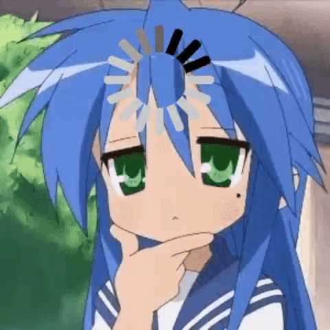
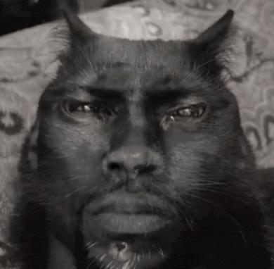
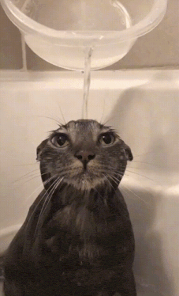
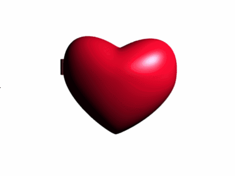

# Welcome to my Profile!

 Game Developer | Scripting Enjoyer

---

## Connect With Me

  
  

---

## Languages I'm Actively Learning

  
  

---

## Profile Stats

---

## Goofy ahh gifs

  
  
  
  
  
  
  
  
  

---

Thanks for visiting my profile!
